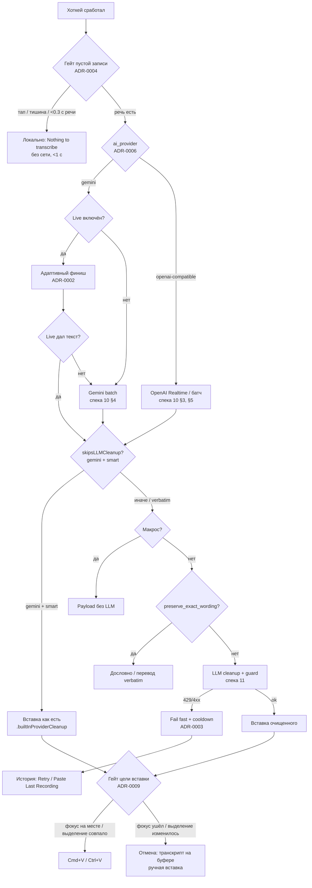

# Дерево принятия решений

Точки, где поведение выбирается явно, со ссылками на ADR и спеки.

## Рантайм-путь диктовки

## Выбор решения по вопросу

| Вопрос | ADR | Короткий ответ |
|---|---|---|
| Форк или переписка? | 0001 | Переписка, спеки — источник правды |
| Ждать ли turnComplete от Gemini Live? | 0002 | Нет — адаптивный финиш по тишине interim |
| Ретраить ли 429 с аудио? | 0003 | Никогда; только транзиентные ошибки ×3 |
| Звать ли провайдера для пустой записи? | 0004 | Нет — локальный гейт |
| Какой оверлей показывать? | 0005 | Один, карточка 480×64 |
| Прогонять ли Gemini-транскрипт через LLM? | 0006 / 0010 | В smart — нет (cleanup встроен); в verbatim — да, через OmniFlow cleanup |
| Куда класть новую настройку? | 0007 | Вкладка по ментальной модели, не General |
| Показывать ли GitHub-промо/звёзды в UI? | 0008 | Нет |
| Вставлять ли вслепую? | 0009 | Нет — гейт цели: фокус + выделение перечитываются перед нажатием |
